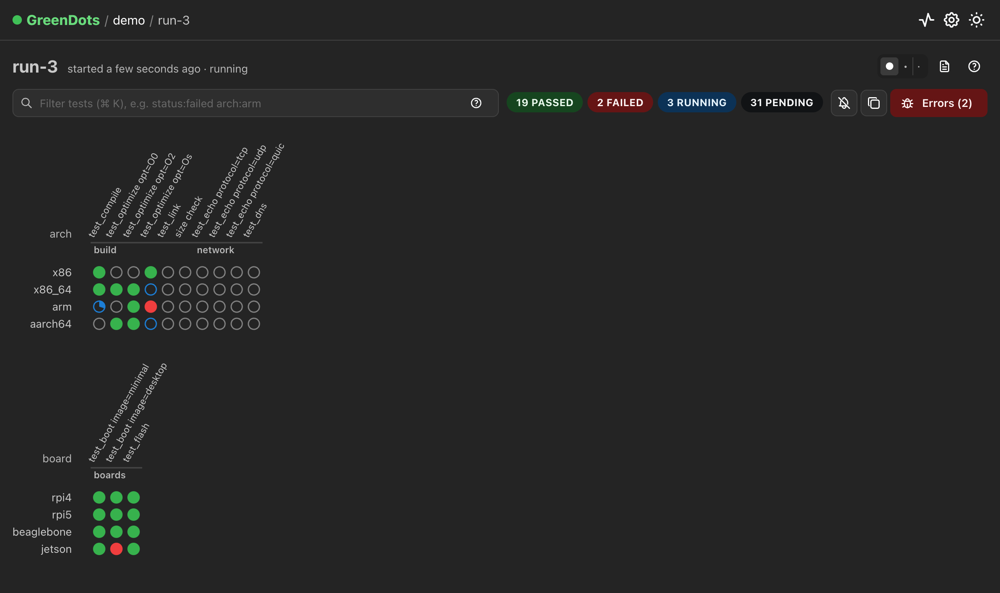
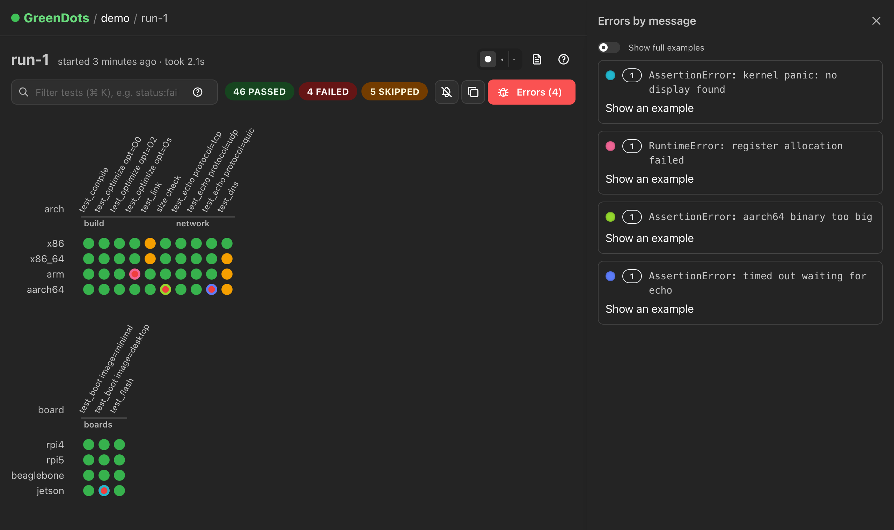
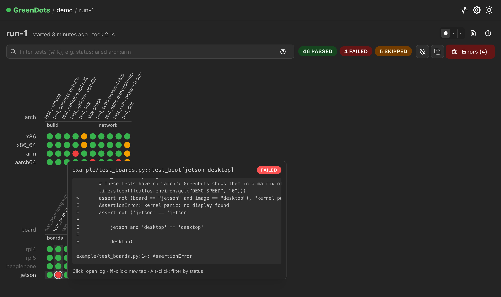
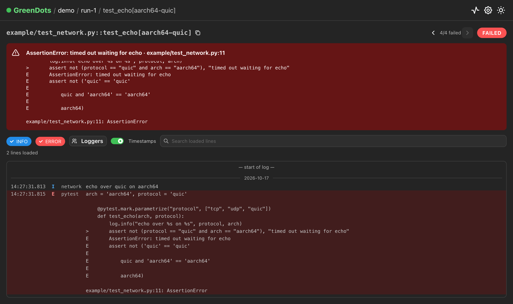

# GreenDots 🟢

> [!WARNING]
> **This project is 100% vibe-coded.** Every line of it, the plugin, the web app, the tests and this README, was
> written by an AI (Claude) from prompts, without a human writing or line-by-line reviewing the code. It's tested and
> used, but read it with that in mind before relying on it.

A live test-matrix viewer for pytest. Every test is a dot, rows and columns are test parameters, and dots fill in
while the run is going. Hover a dot for its log tail or failure, click it for the full log, and group failures by
their error message.

It's built for big suites (20k+ tests, logs of any size) and for run data on network shares, where every `ls`,
`stat` and `read` is a slow round trip. The test runner and the viewer only share directories:

- **[`pytest-greendots/`](pytest-greendots)**: the pytest plugin. It writes each run's plan, an append-only status
  stream per worker, and a log per test that captures **all** output: log records of every logger, `print`s, and
  raw writes to stdout and stderr by subprocesses and C code, live.
- **[`greendots/`](greendots)**: the files a run is made of, as typed models and their layout, shared by the plugin
  and the client.
- **[`greendots-client/`](greendots-client)**: reads runs from Python: a project's runs, a test's result, its log
  (live, too), or waiting for a run to finish.
- **[`web/`](web)**: a Next.js + Mantine app that runs on your machine. It mirrors the directories into memory,
  touching them as little as possible, and serves the UI, a single-page app that gets live updates over server-sent
  events. It also reads runs written by the original GreenDots plugin.

| A run in progress | Failures grouped by error |
| --- | --- |
|  |  |
| **Hover a dot for its failure or log tail** | **A test's full log** |
|  |  |

## Getting started

You need Python ≥ 3.9 for the plugin and [Bun](https://bun.sh) (or Node ≥ 22 with npm) for the web app.

### 1. Install the plugin into your test environment

```bash
pip install ./greendots ./pytest-greendots
```

### 2. Run your tests with `--greendots`

Give each run its own directory under `<source>/<project>/`, where a source is a directory the web app can read,
like a local one for local runs and a network share for CI:

```bash
pytest --greendots=/var/opt/greendots/my-project/$(date +%Y-%m-%d_%H-%M-%S)
pytest --greendots=/media/greendots/my-project/ci-$CI_JOB_ID -n 8   # works with pytest-xdist
```

The original plugin's options (`--livelog`, `--livelog-worker-id`, `--livelog-worker-count`, `--skip-plan-creation`)
work too.

### 3. Start the web app

```bash
cd web
bun install
bun run build
bun run start
```

Open <http://localhost:3000>, go to **Settings** and add your sources (e.g. `local` → `/var/opt/greendots` and
`network` → `/media/greendots`). Projects with the same name in several sources are shown together.

On the home page, **pin** (📌) the projects you care about to the top (pins are kept in your browser), and **sync**
(↻) the ones whose latest runs you want kept up to date even while you're not looking.

### Or install the Fedora package

`packaging/fedora/build.sh` builds RPMs in a Fedora container (needs Podman) into `packaging/fedora/rpms/`:
`greendots`, a `greendots` service on `0.0.0.0:7357` that reads runs from `/var/opt/greendots2` (a directory every
user can write runs to), `python3-pytest-greendots`, the plugin, `python3-greendots-client`, the Python client, and
`python3-greendots`, which they share.

```bash
packaging/fedora/build.sh
sudo dnf install packaging/fedora/rpms/*.$(arch).rpm packaging/fedora/rpms/*.noarch.rpm
sudo systemctl enable --now greendots
sudo firewall-cmd --reload && sudo firewall-cmd --permanent --add-service=greendots && sudo firewall-cmd --reload   # if needed
```

Open <http://localhost:7357> (or this machine's address from another one). Its config is
`/etc/greendots/config.json`, also edited on the Settings page.

Then write your runs into `/var/opt/greendots2/<project>/`:

```bash
pytest --greendots=/var/opt/greendots2/my-project/$(date +%Y-%m-%d_%H-%M-%S)
```

The system Python has the plugin already. A virtualenv doesn't see it, so add the plugin to the project instead,
e.g. `pip install /path/to/GreenDots/greendots /path/to/GreenDots/pytest-greendots`.

The build downloads Bun and the web app's dependencies, so it needs the internet. The `greendots` RPM holds native
modules, so build it on the architecture you install it on (`FEDORA=43 packaging/fedora/build.sh` targets another
release). Its release number is the commit count, so a newer build installs as an upgrade.

### Try it out with the demo suite

```bash
uv run --project pytest-greendots pytest example --greendots=example-data/local/demo/run-1
DEMO_SPEED=0.1 uv run --project pytest-greendots pytest example -n 2 --greendots=example-data/network/demo/run-2 &
echo '{"sources": [{"name": "local", "path": "'$PWD'/example-data/local"},
                   {"name": "network", "path": "'$PWD'/example-data/network"}]}' > example-data/greendots.json
cd web && bun install && bun run dev   # uses ../example-data/greendots.json
```

## Settings

Everything is configured in one JSON file, also edited on the Settings page:
`$XDG_CONFIG_HOME/greendots/config.json` (`~/.config/greendots/config.json`), or the path in `$GREENDOTS_CONFIG`.
Every key is optional:

```json
{
  "sources": [{ "name": "local", "path": "/var/opt/greendots" }, { "name": "network", "path": "/media/greendots" }],
  "synced": ["my-project"],
  "server": { "host": "127.0.0.1", "port": 3000 },
  "polling": { "run": 1, "slowRun": 60, "slowAfter": 600, "stopAfter": 3600, "list": 10, "browse": 300, "recentRuns": 5 },
  "filesystem": { "concurrency": 8, "timeout": 30, "chunk": 1024 },
  "logs": { "window": 256, "preview": 16 },
  "activity": 5000
}
```

Times are in seconds and sizes in KB. The server listens on localhost only; set `server.host` to `0.0.0.0` to share
it (it takes effect on restart).

## Using the UI

- **Filter** (Ctrl/⌘ K) exactly like `pytest -k`: `test_run and not ssh`, `(compile or link) and x86`. A word
  matches tests with it in their directories, file, class or name with params, markers or other keywords, ignoring
  case. Click a status count to show only tests with that status. Filters are kept in the URL, so you can share
  them. The `?` button has examples.
- **Hover** a dot for its log tail or failure; **click** it to open its log, Ctrl/⌘-click for a new tab, and
  Alt-click to filter by its status. Or press `G` to focus the matrix and use the arrow keys and `Enter`. `?` lists
  the shortcuts.
- **Errors** (Ctrl/⌘ E) groups failures by their pytest headline (the first `E ...` line), rings the dots by error,
  and highlights an error's tests on hover. Click an error to filter to it.
- The dot size (●•·) fits big matrices on screen; suites without row params get rows of dots per module. Drag the
  edges of the top-left corner to resize the column headers and row labels (double-click to reset).
- The 🔔 sends a browser notification on the first failure and when the run finishes; a fully green run gets
  confetti. The copy button copies the ids of the shown tests, ready to paste into `pytest`.
- **Session logs** show output from outside of tests (e.g. while importing test modules), per worker, and files that
  failed to collect are listed above the matrix.
- **Logs** open at their end, load older lines as you scroll up, and follow new lines live. Filter by level and
  logger, search, toggle timestamps, jump between failed tests; `Esc` goes back. No line is ever dropped: lines too
  long to show inline open in a viewer that pages through them (and copies or downloads them), however big.
- **Activity** (the pulse icon) lists the latest filesystem operations, syncs and API requests, so you can see what
  GreenDots costs your share.
- Projects and runs can have display names: put `name = "..."` in a `metadata.toml` in their directory.

## Customizing the matrix

By default a test's column is its module, name and params, and the rows are the params that all parametrized tests
share. Tests that don't fit one matrix get several: first the tests with the row params, then, over and over, the
tests sharing the param most of the rest have (their rows are the params they all share), and last the tests without
params. It's all decided by the web app, so runs of either plugin version are split the same way.

### Choose the rows

```python
# conftest.py
import pytest

@pytest.fixture(scope="session")
def greendots_row_params() -> list[str]:
    return ["arch", "os"]
```

Or in `pytest.ini`: `greendots_row_params = arch os`.

### Rename a test, or change its column group or params

```python
import pytest
from greendots.plugin import TestInfo

@pytest.mark.greendots(name="boot", module="smoke", params={"board": "rpi4"})
def test_boot_rpi4_with_default_config() -> None: ...

def test_boot(board: str, greendots: TestInfo) -> None:
    greendots.update(name="boot", params={"board": board})  # while it runs
```

### Change every test at once

```python
# conftest.py
from __future__ import annotations

from typing import TYPE_CHECKING

import pytest

if TYPE_CHECKING:
    from greendots.plugin import PlanTest

@pytest.hookimpl(optionalhook=True)  # the conftest keeps working without the plugin
def pytest_greendots_test(item: pytest.Item, test: PlanTest) -> None:
    test["module"] = test["module"].removeprefix("test_")  # test_network -> network
    test["params"].pop("seed", None)  # one column, whatever the seed
```

Params are shown with `str()`, unless their value has a `__greendots_format__()` (or `__livelog_format__()`)
method.

### Report progress

Running dots fill up like a pie:

```python
from greendots.plugin import Progress

def test_flash(greendots_progress: Progress) -> None:
    for block in greendots_progress.track(range(64)):
        ...  # flash the block

def test_update(greendots_progress: Progress) -> None:
    download, install = greendots_progress.split(2)  # each goes from 0 to 1
    download(0.5)
    download.done()
    install.sleep(5)  # fills up over 5 seconds
```

The original plugin's `live_progress` fixture works too.

### More options

- `greendots_log_level = INFO` in `pytest.ini` records only logs of that level and above (default: `DEBUG`).
- Several pytest processes (e.g. on several machines, each optionally with xdist) can write to the same run: give
  each `--greendots-worker-id=<i> --greendots-worker-count=<n>`. Process 0 writes the plan.

## Read runs from Python

[`greendots-client`](greendots-client) reads the same directories, from the terminal or from Python
(`pip install ./greendots ./greendots-client`):

```bash
greendots-client wait my-project/ci-123 --timeout 3600 && echo all passed
greendots-client log my-project "test_flash[rpi4]" -f
```

For example, to wait for a CI run and report its failures:

```python
from greendots.client import Source

run = Source("/media/greendots").project("my-project").latest()
summary = run.wait(timeout=3600)
for result in run.failures():
    print(result.test.id, run.log(result.test.id).tail(5))
```

## What gets written

The same layout as the original plugin, so either version of each side works with the other:

```text
<source>/<project>/[metadata.toml]
<source>/<project>/<run>/
├── plan.json                   # tests grouped by module, row_params, worker_count and collection errors
├── status.<worker>.jsonl       # append-only events: start, setup/call/teardown (+exception/reason), progress,
│                               # finish, plan_update (from the fixtures) and session_finish
├── <test id>.log.jsonl         # {"name", "level", "time", "message"} per log record, output line and failure
├── session.<worker>.log.jsonl  # the same, for output outside of tests
└── [metadata.toml]
```

Nothing a test outputs is missing from its log:

- log records of **every** logger, including ones that don't propagate to the root logger;
- `print`s and other writes to `sys.stdout`/`sys.stderr`, live (`capsys`, `-s` and `--capture=tee-sys` keep working);
- raw writes to file descriptors 1 and 2 (subprocesses, C extensions, `os.write`), live, through a pipe that passes
  them on unchanged (except in tests using `capfd`, which reads the descriptors itself);
- warnings, failures and skip reasons, and tests that were interrupted (Ctrl+C) or whose xdist worker crashed;
- output while collecting (e.g. importing test modules) goes to the session log, and collection errors to the plan.

## How the web app spares the share

The Activity page shows every filesystem operation. The rules:

- **Nothing is read for pages nobody looks at.** Browsers get updates over one event stream per tab, closed while the
  tab is hidden (unless its notifications are on); only open streams and synced projects make the server read.
- **Listings come from a cache** and are refreshed in the background: every `polling.list` seconds for projects
  being viewed or with runs in progress, every `polling.browse` for the rest. Each run directory is `stat`-ed once.
- **A run's `plan.json` is read once.** Status files are tailed by byte offset: one `stat` per worker per check,
  and a read of only the new bytes when a file grew. Workers that finished are never read again, nor are finished
  runs.
- **Runs are checked every `polling.run` seconds while they change**, every `polling.slowRun` once they haven't
  changed for `polling.slowAfter`, and **not at all after `polling.stopAfter`** (e.g. a crashed run). Its page then
  offers to check again.
- **A followed log is `stat`-ed at most once per check**, however many tabs follow it, and not anymore once its test
  is over and it stopped growing. Logs are read in `logs.window` KB pieces.
- **Slow or unreachable shares don't hang the app**: at most `filesystem.concurrency` operations run at a time,
  callers give up after `filesystem.timeout` seconds (per operation: files are read in `filesystem.chunk` KB
  pieces, so big plans, status files and logs load however slow the share is), pages show what's known while the rest loads, and one bad
  source doesn't hide the others. `bun run start` also enlarges Node's I/O thread pool, so a hung share can't block
  it.

The API is described at `/api`.

## Development

```bash
cd pytest-greendots && uv run pytest                        # plugin tests (pytester, incl. xdist and capture modes)
cd greendots-client && uv run pytest                        # client tests, on runs the plugin writes
for p in greendots pytest-greendots greendots-client; do (cd $p && uv run ruff check && uv run ruff format --check && uv run mypy && uv run pyright); done
cd web && bun run test && bun run lint                      # web app tests (vitest) and Biome
cd web && bun run dev                                       # the UI on http://localhost:3000
```

In `web/src`: `lib/` holds the logic (`store.ts` decides what to read when, `run.ts` tails one run, `logs.ts` reads
logs of any size, `fs.ts` wraps the filesystem, `config.ts` describes the settings, `client.ts` has the browser's
stream hooks), `views/` the pages (routed in the browser by `views/App.tsx`), `components/` the rest of the UI, and
`app/api/` the HTTP API.
